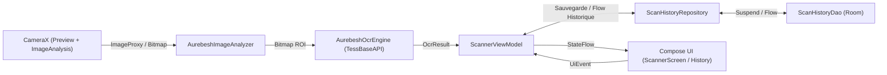

# ARCHITECTURE.md — Architecture & Cartographie du Code

> Ce document décrit l'architecture cible, le flux de données et l'emplacement exact des fichiers du projet **OCRAurebesh** afin d'éviter toute exploration inutile du codebase.

---

## 1. Vue d'Ensemble (Clean MVVM, UDF & Persistance Locale)



---

## 2. Organisation des Packages (`fr.antoinehory.ocraurebesh`)

```text
fr.antoinehory.ocraurebesh/
├── MainActivity.kt              # Point d'entrée unique, configuration Edge-to-Edge
├── ui/
│   ├── theme/                   # Thème Material 3 (Color, Theme, Type)
│   ├── components/              # Composants UI réutilisables (Overlay viseur, carte résultat, demande permission)
│   ├── scanner/                 # Écran principal de scan (ScannerScreen, ScannerViewModel, ScannerUiState)
│   └── history/                 # Écran / BottomSheet d'historique et favoris des traductions sauvegardées
├── camera/                      # Intégration CameraX et ImageAnalysis.Analyzer
├── ocr/                         # Gestion des assets tessdata, prétraitement Bitmap et wrapper TessBaseAPI
├── data/
│   ├── local/
│   │   ├── AppDatabase.kt       # Instance RoomDatabase
│   │   ├── dao/                 # Interfaces @Dao (ScanHistoryDao)
│   │   └── entity/              # Entités Room (@Entity ScanHistoryEntity)
│   └── repository/              # Repositories (ScanHistoryRepository)
└── domain/                      # Modèles métier purs (OcrResult, ScanRecord)
```

---

## 3. Cartographie des Fichiers Actuels

*Mettre à jour ce tableau à chaque création, modification structurante ou suppression de fichier.*

| Chemin relatif | Responsabilité | Statut |
| :--- | :--- | :--- |
| `AGENTS.md` | Point d'entrée IA, index documentaire, catalogue de skills et garde-fous | Actif |
| `docs/ARCHITECTURE.md` | Architecture MVVM/UDF, pipeline OCR/Room et cartographie des fichiers | Actif |
| `docs/CODING_STANDARDS.md` | Standards de code Kotlin/Compose et bonnes pratiques CameraX/Tesseract/Room | Actif |
| `docs/ROADMAP.md` | Suivi d'avancement par phases | Actif |
| `docs/DECISIONS.md` | Journal des décisions d'architecture (ADR) | Actif |
| `build.gradle.kts` | Configuration Gradle racine (plugins Android Application, Kotlin Compose, KSP) | Actif |
| `gradle/libs.versions.toml` | Catalogue des versions (CameraX, Accompanist, Tesseract, Room, KSP) | Actif |
| `app/build.gradle.kts` | Configuration du module `:app` (minSdk 29, targetSdk 37, Compose, KSP, Room) | Actif |
| `app/src/main/AndroidManifest.xml` | Déclaration permission `CAMERA`, feature camera et `MainActivity` | Actif |
| `app/src/main/java/fr/antoinehory/ocraurebesh/MainActivity.kt` | Activité hôte Jetpack Compose | Squelette initial |
| `app/src/main/java/fr/antoinehory/ocraurebesh/ui/theme/Color.kt` | Palette de couleurs Material 3 | Actif |
| `app/src/main/java/fr/antoinehory/ocraurebesh/ui/theme/Theme.kt` | `OCRAurebeshTheme` | Actif |
| `app/src/main/java/fr/antoinehory/ocraurebesh/ui/theme/Type.kt` | Typographies Material 3 | Actif |

---

## 4. Pipeline OCR & Caméra (Spécifications Techniques)

1. **Initialisation des données Tesseract (`tessdata`)** :
   - `TessBaseAPI` requiert un chemin sur le système de fichiers local (et non directement dans les `assets` compressés de l'APK).
   - Au démarrage, copier le fichier `.traineddata` depuis `app/src/main/assets/tessdata/` vers `context.filesDir/tesseract/tessdata/` s'il n'est pas déjà présent.
   - Initialiser `TessBaseAPI().init(dataPath, languageCode)` où `dataPath` est le dossier parent contenant `tessdata/` (`context.filesDir/tesseract/`).

2. **Capture & Prétraitement (`camera/` -> `ocr/`)** :
   - Utiliser `ImageAnalysis` avec `STRATEGY_KEEP_ONLY_LATEST`.
   - Convertir l'`ImageProxy` en `Bitmap`, appliquer la rotation correspondant à `imageProxy.imageInfo.rotationDegrees`.
   - Découper (crop) uniquement la zone cible (viseur / ROI) pour accélérer drastiquement l'OCR et éviter le bruit visuel autour du texte Aurebesh.
   - Fermer immédiatement l'`ImageProxy` via `use {}`.

3. **Reconnaissance & Restitution (`ocr/` -> `ui/`)** :
   - Exécuter `tessBaseApi.setImage(croppedBitmap)` puis `tessBaseApi.utF8Text` sur un thread d'arrière-plan séquentiel.
   - Publier le texte reconnu et le niveau de confiance (`meanConfidence`) dans `ScannerUiState`.

---

## 5. Persistance Locale avec Room (`data/local/`)

- **Entité principale (`ScanHistoryEntity`)** :
  - `id: Long` (Clé primaire auto-générée)
  - `translatedText: String` (Texte traduit depuis l'Aurebesh)
  - `confidence: Int` (Score de confiance moyen Tesseract 0-100)
  - `createdAt: Long` (Timestamp epoch millis)
  - `isFavorite: Boolean` (Marquage favori par l'utilisateur)
- **DAO (`ScanHistoryDao`)** :
  - `observeAll(): Flow<List<ScanHistoryEntity>>` (Trié par `createdAt DESC`)
  - `observeFavorites(): Flow<List<ScanHistoryEntity>>`
  - `insert(entity: ScanHistoryEntity): Long` (`suspend`)
  - `toggleFavorite(id: Long, isFavorite: Boolean)` (`suspend`)
  - `deleteById(id: Long)` et `clearAll()` (`suspend`)
